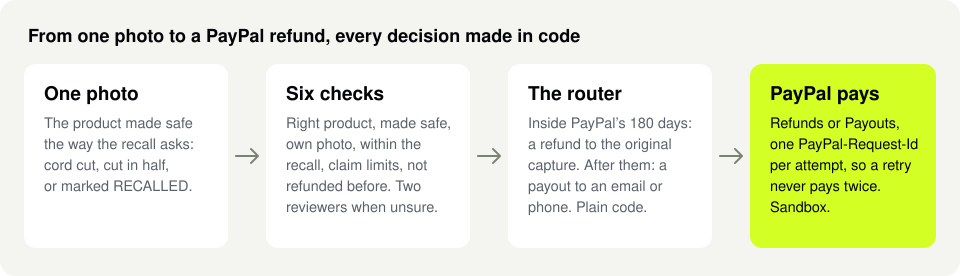

# Remedy

[](https://github.com/usv240/remedy/actions/workflows/ci.yml)

Recall refunds in seconds, for the owners of recalled products and the firms that recall them. The owner makes it safe the way the recall asks (cuts the cord, cuts it in half, or writes "RECALLED" on it) and snaps one photo; Remedy checks that photo against the official recall, and PayPal pays the refund, back to the original purchase when it was bought with PayPal, or as a payout to an email, a phone or Venmo (in the sandbox, a PayPal payout to that phone number stands in for Venmo).

- **Live:** [remedy-y0ym.onrender.com](https://remedy-y0ym.onrender.com) (PayPal sandbox; no login needed)
- **Start here:** [`/evidence`](https://remedy-y0ym.onrender.com/evidence) (a five-minute path, every figure with its source), [`/try`](https://remedy-y0ym.onrender.com/try), [TESTING.md](TESTING.md#buy-claim-and-refund-to-the-original-purchase-about-3-minutes) (your own sandbox purchase) and [`/firm`](https://remedy-y0ym.onrender.com/firm) (the firm's side).
- **Claims to evidence:** [docs/evidence-index.md](docs/evidence-index.md): ten claims, each with its live page, file and line, and test.



## Run it yourself

Node 24 and Docker. Only `DATABASE_URL` is required in `.env.local`; the keys in [`.env.example`](.env.example) are optional.

```bash
git clone https://github.com/usv240/remedy && cd remedy
npm ci
cp .env.example .env.local
docker compose up -d                                # Postgres 17
npm run db:migrate && npm run db:load && npm run db:seed
npx tsx --env-file=.env.local scripts/seed-firm.ts  # sample claims and plan
npm run dev                                         # http://localhost:3300
npm test                                            # 512 passed, 50 skipped without a database or keys
```

Without a Claude key, every model answer shown is a recorded one (on `/try`, labelled Recorded or Replayed) while the six checks in code, PayPal sandbox payments and the firm console run live; what it leaves out is a model reading a new photo, which goes to a person at the firm instead. Bryntum Gantt runs its trial build, with a trial watermark, and without an AG Grid key the queue runs AG Grid Community.

[CI](.github/workflows/ci.yml) runs audit, types, lint and unit tests, then a no-keys build where every page must pass axe ([docs/run-and-test.md](docs/run-and-test.md)).

## Results

Every figure is counted by code from a repo file ([docs/results.md](docs/results.md)).

- **Two error rates, on photos with a known answer:** **paid when it should not have been: 0 of 36** decisions, on 18 photos; **held for a person or a new photo when it could have been paid: 1 of 4**, the sample charger with its cord cut ([`src/components/evidence/errors.ts`](src/components/evidence/errors.ts)).
- **Photos needing a closer look:** **7 of 7** stopped by code alone, before any AI call ([`content/public/verify-runs.json`](content/public/verify-runs.json)).
- **Reading the remedy:** Claude Opus 5.5 with a self-check got every field right on **113 of 130** real CPSC remedies, keyword rules 73 of 130 (draft labels, [`content/recalls/benchmark/results.json`](content/recalls/benchmark/results.json)).

**The difference:** a recall claim portal today pays the refund "via check within 10-15 business days" as [its own page](https://www.recallrtr.com/SiteResources/3in1grill/locales/en/translation.json) states. Remedy's PayPal payout reached the owner **17 to 18 seconds** after approval, in 4 sandbox runs, and a refund to the original PayPal purchase went through at once ([`content/public/measured.json`](content/public/measured.json)). Step by step, with PayPal ids: [`content/public/e2e-transcript.json`](content/public/e2e-transcript.json).

Every payment runs in the PayPal sandbox; the sample firms are fictional; Remedy is not affiliated with the CPSC or any firm.

## Where to look

| | On the site | In the repo |
|---|---|---|
| What it uses | [`/stack`](https://remedy-y0ym.onrender.com/stack), every tool with its files; [`/try/shop`](https://remedy-y0ym.onrender.com/try/shop) | `planPayment()` in [`src/lib/payments/router.ts`](src/lib/payments/router.ts); [`tests/payments.test.ts`](tests/payments.test.ts) |
| A complete product | [`/claim/27056`](https://remedy-y0ym.onrender.com/claim/27056) on a phone; [`/firm/claims`](https://remedy-y0ym.onrender.com/firm/claims) | 124 of 124 page views pass axe: [`tests/e2e/pages-a11y.mjs`](tests/e2e/pages-a11y.mjs); [`tests/photo-privacy.test.ts`](tests/photo-privacy.test.ts) |
| Who it helps | [`/evidence/market`](https://remedy-y0ym.onrender.com/evidence/market): the stake, the problem, who runs it first | [`content/recalls/value.json`](content/recalls/value.json); [`src/lib/research.ts`](src/lib/research.ts), each figure with its source |
| What is new | [`/evidence#first`](https://remedy-y0ym.onrender.com/evidence#first); [`/evidence/market#compare`](https://remedy-y0ym.onrender.com/evidence/market#compare) | [`content/public/network-run.json`](content/public/network-run.json); [`tests/network-run.test.ts`](tests/network-run.test.ts) |

## PayPal, file by file

Orders and Payments are direct calls on the APIMatic-generated PayPal Server SDK's controllers; the rest is REST. All sandbox.

| PayPal | The call | Where | Test |
|---|---|---|---|
| Orders v2, JavaScript SDK v6 | `POST /v2/checkout/orders`, captured server side, for the shop and replacements | [`src/lib/paypal/sdk-rest.ts`](src/lib/paypal/sdk-rest.ts) | [`tests/paypal-sdk.test.ts`](tests/paypal-sdk.test.ts); `tests/e2e/claim-shop.mjs`, 11 of 11 (needs keys) |
| Partner Referrals (production onboarding) | `POST /v2/customer/partner-referrals`, then `PayPal-Auth-Assertion` per firm; this sandbox app got 403 `NOT_AUTHORIZED` (November 7, 2026), so firms connect their own app today | [`src/lib/paypal/firm-account.ts`](src/lib/paypal/firm-account.ts); [`/stack#onboarding`](https://remedy-y0ym.onrender.com/stack#onboarding) | `tests/firm-limits.test.ts` (needs a database) |
| Refund to the original capture | `POST /v2/payments/captures/{id}/refund` with `PayPal-Request-Id`, inside 180 days | [`src/lib/payments/refunds.ts`](src/lib/payments/refunds.ts) | [`tests/payments.test.ts`](tests/payments.test.ts), "refunds to the original capture once" |
| Payouts | `POST /v1/payments/payouts`, one item per claim; bulk pay is one batch | [`src/lib/payments/router.ts`](src/lib/payments/router.ts) | [`tests/payments.test.ts`](tests/payments.test.ts), "paying exactly once"; `tests/e2e/claim.mjs`, 23 of 23 (needs keys) |
| Transaction Search | `GET /v1/reporting/transactions`, 31-day slices, the firm's buyers | [`src/lib/payments/buyers.ts`](src/lib/payments/buyers.ts) | [`tests/payments.test.ts`](tests/payments.test.ts) |
| Disputes | `GET /v1/customer/disputes`, read before any refund (C6) | [`src/lib/payments/refunds.ts`](src/lib/payments/refunds.ts) | [`tests/payments.test.ts`](tests/payments.test.ts) |
| PayPal MCP server | `get_order`, read only, for C6; the Orders API is the fallback | [`src/lib/paypal/mcp.ts`](src/lib/paypal/mcp.ts) | [`tests/paypal-mcp.test.ts`](tests/paypal-mcp.test.ts) |
| Webhooks | Verified with PayPal (signature, or the event looked up by id) on 15 events; `PAYMENT.PAYOUTS-ITEM.UNCLAIMED` becomes a re-notice task | [`src/lib/payments/webhooks.ts`](src/lib/payments/webhooks.ts), [`src/lib/payments/events.ts`](src/lib/payments/events.ts) | [`tests/payments.test.ts`](tests/payments.test.ts); `tests/e2e/firm.mjs` (needs a database) |

Built on ([`/stack`](https://remedy-y0ym.onrender.com/stack)): Claude Opus 5.5 reads remedies into proof rules, describes photos and runs the two reviewers; Claude Haiku 5.5 writes the report summary ([`src/lib/ai/claude.ts`](src/lib/ai/claude.ts), [`src/lib/verify/vision.ts`](src/lib/verify/vision.ts), [`src/lib/verify/reviewers.ts`](src/lib/verify/reviewers.ts)). Elastic searches every recall ([`src/lib/recall/search.ts`](src/lib/recall/search.ts)); Channel3 finds a safe replacement ([`src/lib/channel3.ts`](src/lib/channel3.ts)); Bryntum Gantt holds the plan ([`src/components/gantt/bryntum.ts`](src/components/gantt/bryntum.ts)); AG Grid runs the queue ([`src/components/firm/ClaimsGrid.tsx`](src/components/firm/ClaimsGrid.tsx)); Render hosts it ([`render.yaml`](render.yaml)).

History: the first commit is dated November 5, 2026 and the latest November 8, 2026.

## The problem, and the result

**447 of 1,239** US consumer product recalls since January 2024 (36.1%) already refund an owner who sends a photo of the product made safe, and the number grows each year: 54 in 2024, 151 in 2025 and 242 in 2026 so far ([CPSC Recalls API](https://www.saferproducts.gov/RestWebServices/Recall?format=json&RecallDateStart=2024-01-01), pulled November 5, 2026); of the 525 whose remedy names a photo and a refund, 447 ask for the product made safe and pay a refund for it, 71 ask for a photo of the product as it is, 5 pay store credit and 2 need no photo ([`content/recalls/proof-split.json`](content/recalls/proof-split.json)).

**What is at stake:** those 447 recalls offer **$471.1 million** in refunds at the lowest stated price, or the fixed refund the rule states when lower (442 of 447 state units and a price; 3 pro-rated refunds state no share and 2 records state no price, so those 5 are left out). **$261.2 million** to **$442.8 million** of it stays unclaimed: the lower figure at the CPSC's FY2025 average correction rate across recalls (44.55%), the higher if about 6 in 100 recalled units come back, two measures of different things; each extra point of return sends **$4.7 million** back to owners ([`content/recalls/value.json`](content/recalls/value.json); [`/evidence/market`](https://remedy-y0ym.onrender.com/evidence/market#money)).

**From primary sources**, read November 8, 2026 (with URLs: [docs/research.md](docs/research.md), [`/evidence/market#problem`](https://remedy-y0ym.onrender.com/evidence/market#problem)):

- **44.55%**: the CPSC's FY2025 average correction rate across its recalls, against a 43% target, by a method revised in FY2024 and not comparable with the 6 in 100.
- **91 FR 20138**: the CPSC's April 2026 request for information on recall claims that are not genuine names coordinated online claims and generated destruction photos; on its docket, **767** registrations under one name and one device filing over **400** claims. Remedy's answer: checks in code before any model call, and a hash pool shared across firms.
- **4 to 6 weeks**: a 2025 photo-refund page's stated wait. Across all **10,110** CPSC recall records since 1973, one names PayPal and none names Venmo ([`scripts/recalls/listing-mentions.ts`](scripts/recalls/listing-mentions.ts)). A PayPal payout costs the sender **$0.25**, a paper check its issuer **$2 to $4**. Almost **70%** of Americans had not heard of a recall for anything they own in five years (Consumer Reports).

**Reaching the owner directly moves recalls:** about **50%** of products are corrected when the firm contacts its buyers, against **6%** after a press release ([OECD, 2018](https://one.oecd.org/document/DSTI/CP/CPS(2018)1/FINAL/en/pdf)). Across 338 CPSC recalls from 2001 to 2013, the share of recalled products corrected was **11.4%** higher on average with a full remedy (repair, exchange or refund) than a partial one ([Raithel, Hock and Mafael, 2024](https://link.springer.com/article/10.1007/s11747-023-00967-x)). From a tax credit, not a recall: among 35,050 filers who had not claimed the Earned Income Tax Credit after a first notice, a simpler second notice raised claiming from **14% to 23%**, and showing the amount prominently raised it to **31%** ([Bhargava and Manoli, 2015](https://www.aeaweb.org/articles?id=10.1257/aer.20121493)).

Measured: **0 of 36 paid wrongly**, the photo check in **about 11 seconds**, the PayPal payout in **about 18** ([`content/public/facts.json`](content/public/facts.json)).

**Who pays Remedy:** the firm, a fee per finished claim, set against the $2 to $4 a paper check costs its issuer and the $0.25 a PayPal payout costs the sender ([docs/research.md](docs/research.md)).

## Three ideas at its heart

1. **Each firm that joins makes every other firm safer.** Every claim photo is matched by a 64-bit perceptual hash ([`src/lib/verify/dhash.ts`](src/lib/verify/dhash.ts)) against the 1,779 published pictures of every recall that are distinct enough to tell their recall apart (of 1,825 stored) and every photo already claimed, at any firm. The hash comparison itself takes a median of 2 ms (0.2 to 93.8 ms); reading the photo and answering takes a median of 98 ms (55 to 200 ms), across 7 recorded runs with no model call. **One photo, two firms:** a photo claimed at Brightline Home, sent for Fernway Home's recall, is held for a person before any model call; only the hash and a row id cross ([`content/public/network-run.json`](content/public/network-run.json), [`/evidence#network`](https://remedy-y0ym.onrender.com/evidence#network)). Firms join through `POST /api/v1/hash-pool/register` and `/check` ([`content/public/hash-pool-call.json`](content/public/hash-pool-call.json)); [`content/public/hash-reuse-run.json`](content/public/hash-reuse-run.json) measures the hash on 117 reused copies.
2. **The refund goes back the way it was paid:** to the original PayPal capture inside PayPal's 180-day window, else a payout. Plain code picks the route and the amount (`planPayment()` in [`src/lib/payments/router.ts`](src/lib/payments/router.ts)).
3. **A payout nobody accepts becomes a task:** when PayPal's webhook reports one waiting (`PAYMENT.PAYOUTS-ITEM.UNCLAIMED`), a re-notice task appears in the firm's plan, live ([`src/lib/payments/events.ts`](src/lib/payments/events.ts)).

**What is first here**, beside the nearest thing (sources: [docs/research.md](docs/research.md#what-is-first-here), [`/evidence#first`](https://remedy-y0ym.onrender.com/evidence#first)):

- A made-safe photo checked against a rule read from the official remedy text, then paid in the same flow. Truepic Vision verifies the capture and leaves the decision to the firm's agents.
- A hash pool shared across firms, only a hash and a row id crossing. The Truepic Risk Network (2025) shares device signals among lenders and insurers.
- The refund routed to the original PayPal capture, else a payout, and an unclaimed payout turned into a task. PayPal is already a rail at the largest recall administrator; the one flow from verified photo to money is new.

**The two reviewers** both run on Claude Opus 5.5 and read two different rulebooks, the official pictures and the remedy text; a disagreement goes to a person. Kohli (2026) found that panels from one model family share errors, so the split is by rulebook, and each reviewer's model is one setting (`REMEDY_REVIEWER_MODEL_PRODUCT`, `REMEDY_REVIEWER_MODEL_REMEDY`). Lineage ([`/evidence/photo-checks#lineage`](https://remedy-y0ym.onrender.com/evidence/photo-checks#lineage)).

## See it

| Six checks, in plain words | Refunded to the original PayPal purchase |
|---|---|
|  |  |
| **Two reviewers when a photo needs a closer look** | **The firm's claims queue (AG Grid)** |
|  |  |

## Read more

- [docs/how-it-works.md](docs/how-it-works.md): the six checks, what the AI never decides, its cost.
- [docs/results.md](docs/results.md), [docs/research.md](docs/research.md) (sources, a pilot), [docs/operations.md](docs/operations.md) (security, privacy), [docs/run-and-test.md](docs/run-and-test.md) and [TESTING.md](TESTING.md) (sandbox accounts).

## Sources and credits

- **Recall data and images:** U.S. Consumer Product Safety Commission, public domain, credited wherever they appear; the made-safe examples are the CPSC's own (26125 and 25007).
- **Sample charger:** a real laptop charger by Dmitry G, Wikimedia Commons, public domain, brand marks removed ([`public/samples/charger/CREDITS.json`](public/samples/charger/CREDITS.json)); not recalled by its maker. **Test photo:** "Coffee in a mug", Kurt Kaiser, [CC0 1.0](https://commons.wikimedia.org/wiki/File:Coffee_in_a_mug.jpg). Every fixture: [`content/verify/fixtures/credits.json`](content/verify/fixtures/credits.json).
- **Fonts:** Sentient (ITF Free Font License) and IBM Plex Sans (SIL OFL), licenses in `src/app/fonts/`.

## License

[MIT](LICENSE)
