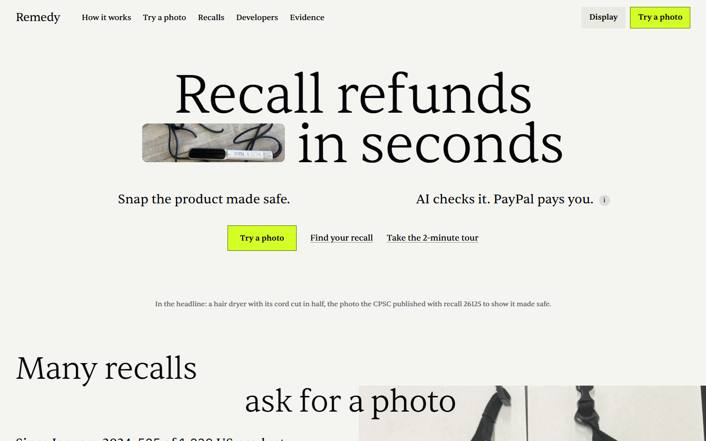
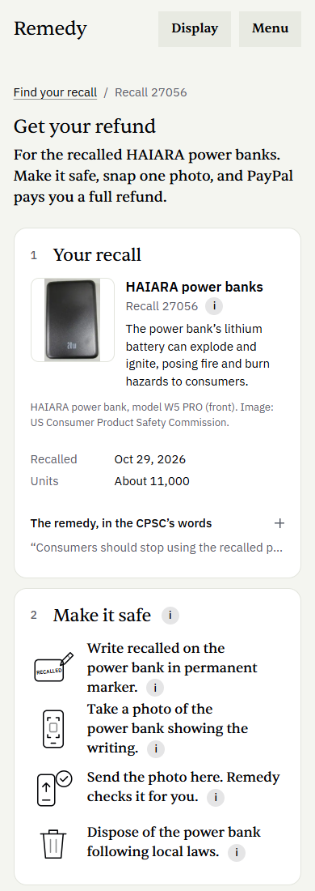
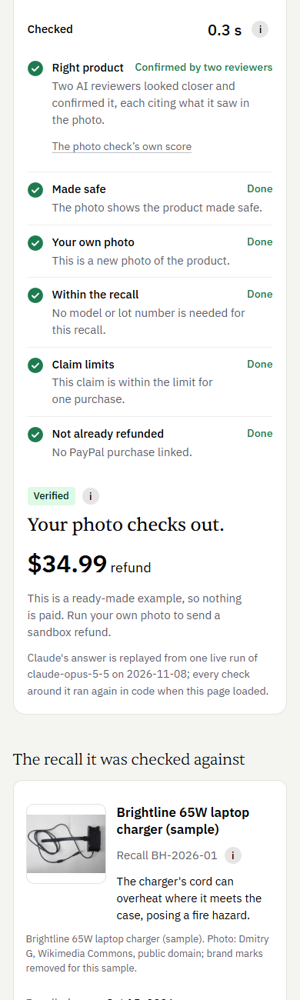
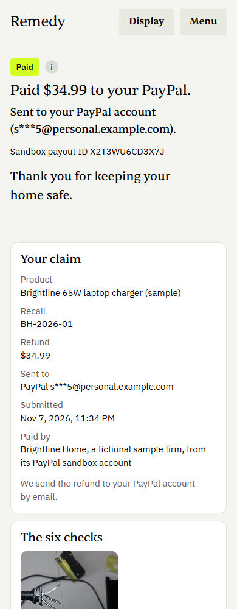
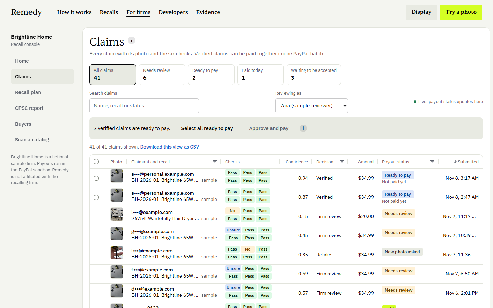
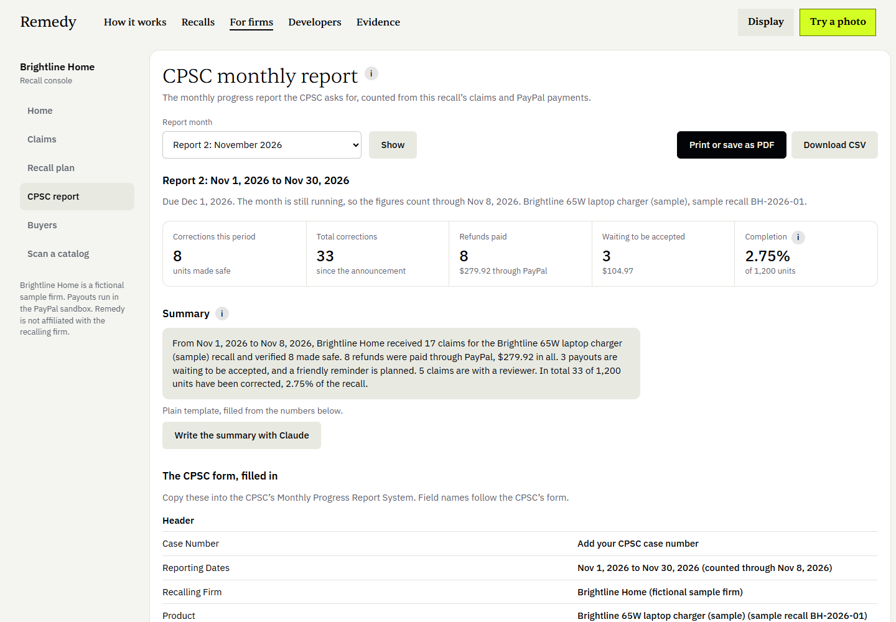
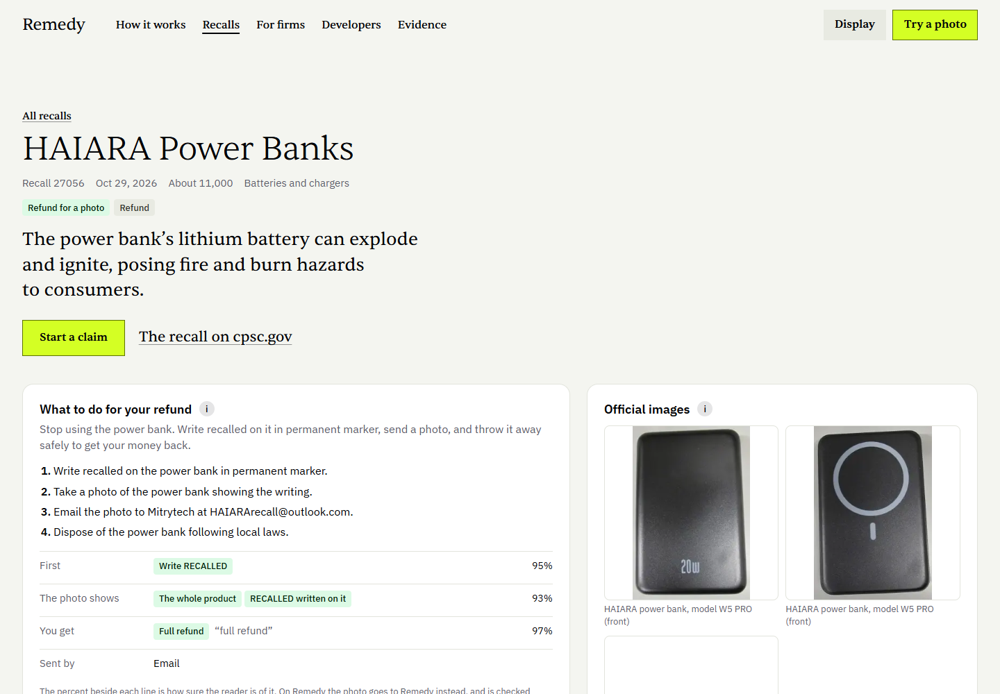

# Remedy

Recall refunds in seconds. The owner of a recalled product makes it safe as the recall asks (cuts the cord, cuts it in half, or writes "RECALLED" on it), snaps one photo, and Remedy checks that photo against the official recall. Once it is verified, PayPal pays the refund, so recalled products leave homes faster.

- **Live demo:** [remedy-y0ym.onrender.com](https://remedy-y0ym.onrender.com) (PayPal sandbox; no Remedy login needed)
- **Start here:** open [`/evidence`](https://remedy-y0ym.onrender.com/evidence). The sandbox buyer login and step-by-step checks are in [TESTING.md](TESTING.md).
- **Demo video:** [youtu.be/VIDEO_ID](https://youtu.be/VIDEO_ID)

Every payment runs in the PayPal sandbox. Brightline Home, the firm in the console, is a fictional sample firm. Real CPSC recalls appear with their real data and credited images; Remedy is not affiliated with the CPSC or any recalling firm.

## The problem in one number

**525 of 1,239** US consumer product recalls since January 2024 (42%) already offer a refund once the owner sends a photo showing the product made safe ([CPSC Recalls API](https://www.saferproducts.gov/RestWebServices/Recall?format=json&RecallDateStart=2024-01-01), public domain, pulled November 5, 2026; counts and definitions in [`content/recalls/stats.json`](content/recalls/stats.json)).

The CPSC's own wording, from recall 27056: *"submit a photo of their recalled power bank with the word 'recalled' written on it in permanent marker"*.

- The share is growing: 71 photo-refund recalls in 2024, 172 in 2025 and 282 in 2026 so far.
- 498 of the 525 list an email address for the claim, and 270 of them list a free webmail address.
- None of the 1,239 recalls mentions PayPal or Venmo.
- 81% of all recalls (1,002 of 1,239) cover fewer than 50,000 units: mostly small firms, handling each photo by hand.

The same classifier, run on the earlier snapshot behind our research note (1,227 recalls to October 29, 2026), gives the same 523 photo-refund recalls it reported.

## Results

- **Reading the remedy, benchmarked (draft labels).** 130 real CPSC remedies (100 photo-refund, 30 not), seven fields each. Claude Opus 5.5 with a self-check got every field right on **113 of 130**; one Claude pass, 110 of 130; keyword rules written the way an engineer would start, 73 of 130. The labels are a draft: a second, more careful Claude pass with a deterministic cross-check, not yet confirmed by a person, so Claude's scores partly measure agreement between two Claude passes ([`content/recalls/benchmark/results.json`](content/recalls/benchmark/results.json)).
- **Every photo-refund remedy, read once.** 583 proof rules (all 525 photo-refund recalls, 30 recent recalls without a photo step and 28 more from the benchmark) in one Message Batches run: 1,166 calls, $14.01 at batch prices, 6.9 minutes ([`content/recalls/proof-rules.json`](content/recalls/proof-rules.json)).
- **Photos that need a second try are found before any AI call.** The recall's official picture, rotated and cropped copies of it, a photo already used for a claim, a blurry photo, and a picture published with a different recall: **7 of 7** asked for a new photo by code alone, each in under 100 ms. A photo of a mug sent for the power bank recall scored 0.02 on the right-product check and was not paid ([`content/public/verify-runs.json`](content/public/verify-runs.json)).
- **Two error rates, on photos with a known answer** (counted by [`src/components/judges/errors.ts`](src/components/judges/errors.ts) from the measured sweep, the recorded presets and the public runs, each model answer once):
  - **paid when it should not have been: 0 of 35** decisions, on 17 photos (copies of the official picture, look-alikes, another product, products not yet made safe, including the sample charger opened up with its cord still attached). Across all four model settings in the sweep: 0 of 72;
  - **held for a person or a new photo when it could have been paid: 0 of 4**, on the owner-style photo with a known answer to pay (the sample charger with its cord cut: its recorded preset answer and three sweep trials, each paid, the product match confirmed by the two reviewers). The CPSC's own published pictures, run with the official-picture match switched off to measure reading, count in neither rate: there the model alone would have paid for the recall's own picture in 3 of 7 runs, which is why the match runs first on every claim and answers that picture in about 60 ms with no model call. The sweep ran three trials per photo ([`content/verify/sweep-results.json`](content/verify/sweep-results.json), and [`content/verify/sweep-sample.json`](content/verify/sweep-sample.json) for the sample recall's three photos at the claim path's setting, $0.41); known answers are in [`content/verify/fixtures/cases.json`](content/verify/fixtures/cases.json).
- **A second line of care.** With the official-image match switched off, Claude Opus 5.5 still recognized the CPSC's example photo for recall 26125 as a downloaded picture rather than an owner's own photo ([`content/presets/recorded/cpsc-example.technical.json`](content/presets/recorded/cpsc-example.technical.json)).
- **Measured in the PayPal sandbox** ([`content/public/measured.json`](content/public/measured.json)):
  - 17 to 18 seconds from approval to a PayPal payout reaching SUCCESS, in 4 runs;
  - 12.3 seconds for one live photo check by Claude Opus 5.5;
  - about 60 ms to answer a photo that is the recall's own official picture, with no model call;
  - a sample-shop purchase refunded to its original PayPal capture at once, and a second claim on that purchase declined.

All of these are on [`/evidence`](https://remedy-y0ym.onrender.com/evidence), each with its source file.

## See it

| Recall refunds in seconds: the CPSC's own made-safe photo sits in the headline | On a phone: the recall's remedy as a checklist |
|---|---|
|  |  |
| **Six checks, in plain words** | **Paid through PayPal** |
|  |  |
| **Back to the original PayPal purchase, inside 180 days** | **Two reviewers when a photo needs a closer look** |
|  |  |
| **The firm's claims queue (AG Grid)** | **The recall plan updates itself (Bryntum Gantt)** |
|  |  |
| **The CPSC monthly report, drafted from the numbers** | **Every recall, read as a proof rule** |
|  |  |

## How it works

1. **Recall.** Claude Opus 5.5 reads the official remedy into a structured proof rule: what to cut or mark, the words to write, what the photo must show, and the refund. The owner sees it as up to four short steps.
2. **Photo.** The owner opens the claim link on a phone and takes one photo. No account. A blur and light check runs in the browser before upload.
3. **Checks.** Six checks, each with a plain reason:

   | Check | What it asks | How |
   |---|---|---|
   | C1 Right product | Is it the recalled product? | Claude vision against the official CPSC images, product names and model numbers; passes at 0.85 |
   | C2 Made safe | Was it made safe as the recall asks? | Claude vision checks each required action; marker words are read and compared in code |
   | C3 Your own photo | Is it the owner's own photo? | A 64-bit perceptual hash (dHash) against the recall's official images and earlier claim photos within 10 bits, and against the 1,777 distinct published pictures of every other recall and every photo claimed on any recall within 4 bits, in all eight orientations; Claude checks for a photo of a screen or printout |
   | C4 Within the recall | Is it a recalled model, lot or date? | Identifiers read from the photo, compared in code with the recall's ranges, when the rule needs them |
   | C5 Claim limits | Is it within the units bought and the recall's units? | Code, per payee |
   | C6 Not already refunded | Has the linked PayPal purchase been refunded or disputed? | PayPal's capture, its order's refunds and the Disputes API |

4. **Decision, in code.** Verified when all six pass and the amount is at or under the firm's auto-approve cap. Retake, with friendly guidance, when the product is not made safe yet, the photo is blurry, it is not the owner's own, or a person (a face, a body, a child) is in it. Otherwise two Claude reviewers look, one seeing only the official images and the other only the remedy text; each must cite what it saw, and a referee in code acts only when both counted votes agree. Anything else goes to a person at the firm.
5. **Payment, in code.** A purchase made with PayPal in the last 180 days is refunded to its original capture. Otherwise the owner chooses a PayPal payout by email or phone, Venmo, or a safe replacement. The refund is the firm's amount or the purchase amount, whichever is lower.
6. **The firm's side.** A claims queue, a corrective-action plan that adds a re-notice when a payout waits to be accepted, and the CPSC monthly progress report.

Claude reads remedies and photos. The money math, the decision and the payment route are plain code, never the model.

## What the AI never decides

| Plain code decides | Where |
|---|---|
| Whether a claim is paid, sent to a person, or asked for a new photo | `decide()` in [`src/lib/verify/decide.ts`](src/lib/verify/decide.ts) |
| Every pass mark (0.85 for the right product, 0.7 for a made-safe step) | `LIMITS` in [`src/lib/verify/checks.ts`](src/lib/verify/checks.ts) |
| The refund amount: the firm's amount or the purchase amount, whichever is lower | `computeAmount()` in `checks.ts`; [`src/lib/payments/router.ts`](src/lib/payments/router.ts) |
| Which recall and proof rule a claim is checked against | `ruleFor()` in [`src/app/api/claims/_lib/recall.ts`](src/app/api/claims/_lib/recall.ts) |
| The marker word, model and lot ranges, claim limits, the match with official and earlier photos on every recall, and when the screen signs Claude lists outweigh its own label | `checks.ts` (`CONTRADICTING_SIGNS`), `identifiers.ts`, `dhash.ts` (`CATALOG_MAX_DISTANCE`) |
| When money moves and to whom: the auto-approve cap, the refund to the original purchase inside 180 days, or the payout | `planPayment()` in `router.ts` |
| Deleting a photo that shows a person, and every owner's photo 90 days after the decision | [`src/lib/ops/photos.ts`](src/lib/ops/photos.ts) |

What Claude does instead: it reads each remedy into a proof rule once, ahead of any claim; it describes the photo (how closely it matches, whether each step is done, any writing or label, whether it is a camera photo, whether a person is in it); two reviewers cite what they see when a check is unclear, and a referee in code counts only votes whose evidence checks out; it reads unclear rows in a catalog scan; and Claude Haiku 5.5 writes the monthly report's summary from numbers SQL counted.

## Grounded in research

Published findings Remedy is built on, each read from the source itself. The same list is on [`/evidence#research`](https://remedy-y0ym.onrender.com/evidence#research).

| Finding | In Remedy | Source |
|---|---|---|
| A full refund lifts the share of recalled products that come back by **11.4%** on average, across 338 CPSC recalls; owners see more benefit and feel more able to take part | Each claim names the refund in its first line (481 of the 583 proof rules state it plainly), and the remedy becomes up to four plain steps with a drawing for each | Raithel, Hock and Mafael, [Journal of the Academy of Marketing Science](https://link.springer.com/article/10.1007/s11747-023-00967-x), 2024 |
| In an IRS field experiment with 35,050 tax filers, a simpler notice raised claiming from **14% to 23%**, and naming the amount in the headline raised it to **31%** | One page on a phone, no account, one photo, and the refund named up front | Bhargava and Manoli, [American Economic Review](https://www.aeaweb.org/articles?id=10.1257/aer.20121493), 2015 |
| On average, about **6 in 100** recalled products come back through a recall, by the CPSC's measure | A finished claim takes one photo: the check runs in about 12 seconds and the PayPal payout in about 18, measured in the sandbox | CPSC Recall Effectiveness Workshop, 2017, as cited by Raithel, Hock and Mafael, 2024 |
| The CPSC's January 2025 order has Amazon email each buyer directly and refund the full price on proof of destruction or disposal, for **400,000+** products | The same pattern for any firm: buyers who paid with PayPal are found through Transaction Search, and each proof photo is checked and refunded | [CPSC](https://www.cpsc.gov/Newsroom/News-Releases/2025/CPSC-Issues-Final-Order-to-Amazon-com-Outlining-Remediation-Plans-for-Hazardous-Products), January 17, 2025 |
| The difference hash treats pictures more than **10 bits** apart as different images, and 1 to 10 bits as variations, after tests on over 150,000 images | Matched within 10 bits to the recall's own pictures, and within 4 bits to the 1,777 distinct pictures of every other recall | Neal Krawetz, [Kind of Like That](https://www.hackerfactor.com/blog/index.php?/archives/529-Kind-of-Like-That.html), 2013 |
| **440 million** active PayPal accounts at the end of September 2026 | Refunds go back to the original PayPal purchase inside 180 days, or out as a payout to an email or phone number, with no bank details asked | PayPal Holdings, [third-quarter 2026 results](https://www.sec.gov/Archives/edgar/data/1633917/000163391726000086/pypl3q-26earningsrelease.htm), October 27, 2026 |

## A 30-day pilot

One small firm with an open photo-refund recall runs every claim on that recall through Remedy for 30 days, from its own claim link, beside its current inbox. Two outcomes, each against the month before:

| Outcome | Baseline | Already recorded in |
|---|---|---|
| Time from photo to refund | The firm's median days from an emailed photo to its refund, from its own records for the 30 days before | Each claim's `claim.submitted` and `claim.paid` entries in the audit ledger and the payment's `paid_at`, shown in the firm's claims queue |
| Share of claims a person had to open | Every emailed photo, read by hand today | Each claim's decision in the `claim` table and the ledger's `claim.decided` entries, and the queue's Needs review view |

**Why it holds up:** an established tool that adds the same model gains a reader of photos; what makes each payout safe to send is the checks in code, the hash-chained evidence behind every payment, and the error rates measured on photos with known answers. It also grows with use: every claim photo is checked against the published pictures of every recall and every photo already claimed on any recall, at any firm, by a 64-bit hash alone, so each firm that joins makes every other firm's refunds safer.

## What is inside

Each tool has one job. [`/stack`](https://remedy-y0ym.onrender.com/stack) lists them with their files, and [`/status`](https://remedy-y0ym.onrender.com/status) shows whether each is live or on its fallback.

- **PayPal** pays the refund. All calls go to the sandbox ([`src/lib/payments`](src/lib/payments)).
  - **Payouts:** one item per claim (`sender_item_id` is the claim id), to an email or a US phone number. Venmo falls back to a phone payout in the sandbox, labelled. Bulk **Approve and pay** sends the chosen claims in one batch.
  - **Refunds:** `POST /v2/payments/captures/{id}/refund` with `PayPal-Request-Id`, inside PayPal's 180-day window.
  - **Orders v2 with the JavaScript SDK v6:** the sample shop at [`/try/shop`](https://remedy-y0ym.onrender.com/try/shop), so anyone can buy, claim and see the refund go back to that payment; and safe replacement orders paid to a retailer stand-in.
  - **Transaction Search:** finds buyers who paid the firm with PayPal, in 31-day slices, matched to the recalled product (`/firm/buyers`).
  - **Disputes:** read before a refund, as part of C6.
  - **Webhooks:** 15 payout, refund and checkout events, each checked with PayPal's signature verification (or PayPal's own record of the event) and handled once. Every status change writes to a hash-chained audit ledger.
- **Claude Opus 5.5** reads every remedy into a proof rule (structured output validated by Zod, then a self-check pass and a deterministic lint, with the Message Batches API), checks each photo with vision, and runs the two reviewers. **Claude Haiku 5.5** writes the monthly report's short summary from numbers SQL counted; any figure not in the report sends it back to a plain template.
- **Elastic** searches every recall in plain words: keyword and semantic retrieval (`semantic_text` on jina-embeddings-v3) fused by reciprocal rank, then reranked by jina-reranker-v3, over the `remedy-recalls` index. It powers the home page showcase, `/recalls`, "Find your recall", the replacement recall check, the API and MCP. Without Elastic, an in-app BM25 search over the same recalls stands in.
- **Channel3** finds a safe replacement: in-stock products at or under the refund amount, each checked against recalls before the owner sees it, then paid with Orders v2. Without a key, the owner is offered a refund.
- **Bryntum Gantt and Scheduler** (trial, with its watermark) hold the corrective-action plan at `/firm/plan`: the announcement, notice waves, payout batches, follow-ups and CPSC reports, with real dependencies. When PayPal reports a payout waiting to be accepted, a re-notice task appears in the open Gantt without a reload (server-sent events). Tasks move by drag or with a form. Below it, the Scheduler shows each review case by reviewer.
- **AG Grid** runs the firm's claims queue at `/firm/claims`: a photo column, masked claimants, the six checks, quick views (Needs review, Ready to pay, Paid today, Waiting to be accepted) and bulk Approve and pay. Each row opens a drawer with the six checks, and the two reviewers' notes when they ran.
- **APIMatic** generated the PayPal Server SDK (`@paypal/paypal-server-sdk`) that carries every Orders and Payments call: the sample shop's checkout and capture, replacement orders, reading captures, and refunds to the original purchase, each with its `PayPal-Request-Id` ([`src/lib/paypal/sdk-rest.ts`](src/lib/paypal/sdk-rest.ts)). Payouts, Transaction Search and Disputes are outside the SDK and use PayPal's REST API.
- **Render** hosts it: [`render.yaml`](render.yaml) is a Blueprint for the web service and Postgres 17, applies the reviewed schema, loads the recall data and seeds the sample firm before each release.
- **MCP server** at `/api/mcp` (streamable HTTP) with seven tools: `search_recalls`, `scan_catalog`, `get_proof_rule`, `verify_photo`, `open_claim`, `claim_status` and `ping`. Found by agents through an MCP Server Card (`/api/mcp/server-card`), an AI Catalog (`/.well-known/ai-catalog.json`), `/llms.txt` and [`server.json`](server.json).
- **For marketplaces and retailers:** `POST /api/v1/scan` checks a whole catalog at once (paste or upload a CSV on `/firm/scan`) and returns, per item, whether an active photo-refund recall covers it and the claim link; `GET /api/embed/badge?recall=` is a one-iframe "Get your refund" badge for any product page. "Find your recall" also asks the FDA and NHTSA when the CPSC has no match, labelled by agency. A daily job pulls each day's new CPSC recalls, reads their proof rules and refreshes search.
- **Public API:** free sandbox keys, OpenAPI 3.1 at `/openapi.json`, docs with recorded responses at `/developers/docs`, and a live playground at `/developers`.

Built with Next.js 16, React 19, TypeScript, Postgres 17, Drizzle, Zod and sharp.

## How the AI cost is kept low

Each photo check is one Claude vision call, made only after the free checks pass. Reading all 583 remedies cost $14.01 in one batch run at half price. Five more measures:

1. **Identical requests replay** in local and test runs: a request that matches one already answered (same model, prompt, images and settings) is read back from `AI_CACHE_DIR` instead of paid for again. It is never set on the hosted site.
2. **An identical photo reuses its result.** The same photo for the same recall, rule and engine version reads the model's answer from the database. Every check that depends on the claim (earlier claims, limits, refunds, the amount) still runs again in code.
3. **Images are downscaled** before the vision call: up to 16% fewer input tokens on large photos, and 13% on a 12-megapixel photo, counted with the token-counting API ([`content/verify/tokens.json`](content/verify/tokens.json)).
4. **The recall's part of the prompt is cached.** Instructions, recall data and official images come first, 71% to 75% of a claim's prompt, so repeat checks on one recall read them from Claude's prompt cache.
5. **A daily spend cap** (`AI_DAILY_USD`, $2 a day on the hosted site). Past it, every free check still runs and a person at the firm looks at the rest. Each call's cost is logged, and today's spend shows on `/status`.

## Running it for real

What the demo runs on today, and what a production deployment changes. Stated as an operating range; live health is on [`/ops`](https://remedy-y0ym.onrender.com/ops) and the load test on [`/evidence#load`](https://remedy-y0ym.onrender.com/evidence#load).

| Part | The demo today | A real deployment |
|---|---|---|
| Web service | One Render Starter instance (0.5 CPU, 512 MB), always on, with the API and MCP server in the same process | Two or more instances behind Render's load balancer, autoscaling on CPU, the same code |
| Checks and payouts | One background worker (`scripts/worker.ts`); a route runs its own job inline if no worker answers in 2 s | Workers scaled with the queue depth shown on `/ops`; the same `job` table |
| Database | A 256 MB Postgres with a 1 GB disk, reached only from this workspace | A larger Postgres with a connection pooler, point-in-time recovery, and backups restored on a schedule to prove they work |
| Your photo | Stored in Postgres as a 1,600 px copy with no EXIF or GPS data, the original cleared once checked; a photo that shows a person deleted at once, every owner's photo 90 days after the decision, its hash kept | Object storage with signed URLs for upload and view, the same deletion rules, the hash kept in Postgres |
| AI | $2 of Claude a day; past it, photos go to a person at the firm | A budget per firm, the Message Batches API for proof rules, the same cache so a repeat photo costs nothing |
| Firm console | Open, for the fictional sample firm | Login and roles per firm (reviewer, compliance lead, read only), every action in the ledger under a named person |
| PayPal | Sandbox, one app, the hosted webhook plus event lookup for local servers | A live app and a registered webhook per environment, the same signature check |
| Limits | 20 API requests a minute without a key, 300 photo claims a day site-wide, each payment under $50 | Limits per firm and per key, set with the firm, counted in the same table |

**Observability.** Every API request runs inside a request context ([`src/lib/log.ts`](src/lib/log.ts)): one JSON log line with the request id, route, status and duration, a row in `request_log`, and `x-request-id` on the response (an incoming `x-request-id` is honored). Every error message ends with its request id, and [`/ops`](https://remedy-y0ym.onrender.com/ops) traces an id to its log lines and ledger entries. Errors go to Sentry when `SENTRY_DSN` is set, with personal data scrubbed first ([`src/lib/sentry.ts`](src/lib/sentry.ts)); without it, nothing changes. Rate limits live in the `rate_limit` table, so they hold across instances and deploys. Photo checks and payouts run as jobs ([`src/lib/jobs`](src/lib/jobs)): a worker takes each one with `for update skip locked`, retries with exponential backoff up to five times, and leaves a failed job with its error for a person; `/status` and `/ops` show the queue and the worker's heartbeat.

## Security and privacy

- **Your photo.** The stored copy is re-encoded by sharp at 1,600 px and carries no EXIF or GPS metadata (a unit test checks it); the untouched upload is cleared once the checks have run. When the vision check sees a person (a face, a body, a child), the owner is asked for a photo of the product alone and the photo is deleted at once. Every owner's photo is deleted 90 days after its claim is decided, by the same housekeeping path that prunes the rate-limit and request-log tables. The SHA-256 and perceptual hash stay, so the earlier-claim check still works, and each deletion writes a ledger entry with no image data ([`src/lib/ops/photos.ts`](src/lib/ops/photos.ts)).
- **Contact details are encrypted at rest** (AES-256-GCM, [`src/lib/secure.ts`](src/lib/secure.ts)), matched by a keyed hash, and shown masked. Where each payout goes is sealed inside its payment plan the same way ([`src/lib/payments/seal.ts`](src/lib/payments/seal.ts)).
- **Between firms, only a hash.** The check against photos claimed on other recalls compares 64-bit perceptual hashes only; no firm sees another firm's photo, claimant or recall ([`src/lib/verify/dhash.ts`](src/lib/verify/dhash.ts)).
- **Tokens are stored only as hashes.** API keys are shown once and kept as SHA-256; personal claim links keep only a fingerprint; visitor addresses in the request log are hashed with a server secret.
- **Webhooks are signature-verified** with PayPal before they change a payment; untrusted events are stored and ignored, and each event id is handled once.
- **Rate limits:** 20 API requests a minute without a key; 60 a minute and 1,000 a day with one; at most 25 full photo checks a key a day; photo claims capped per visitor (6 in 10 minutes, 30 a day) and at 300 a day site-wide; five new keys a day per address.
- **Spend guard:** the daily AI budget above, and payment limits for the public sandbox demo: each payment at most $50, and $500 a day.
- **An audit ledger anyone can check:** claims, payment status changes and webhook events are chained by SHA-256, appends take a Postgres advisory lock, and `GET /api/ledger/verify` recomputes the chain.

## Run it yourself

You need Node 24 and Docker.

```bash
git clone https://github.com/usv240/remedy
cd remedy
npm ci                        # also copies Bryntum Gantt's script into public/bryntum/
cp .env.example .env.local    # fill in what you have; DATABASE_URL is the only one required
docker compose up -d          # Postgres 17 on port 5432
npm run db:migrate            # applies the reviewed schema in db/schema.sql
npm run db:load               # loads content/recalls/: recalls, proof rules and image hashes
npm run db:seed               # the sample firm, Brightline Home
npx tsx --env-file=.env.local scripts/seed-firm.ts   # its sample claims, plan and report history
npm run dev                   # http://localhost:3300
npm run worker                # the job worker, in a second terminal (without it, routes run their jobs inline after 2 s)
```

For a production build: `npm run build`, then `PORT=3400 npm start`. On Render, `render.yaml` adds the worker as a background service with the same environment, plus `SENTRY_DSN` for error tracking (optional). Every service except Postgres is optional: without its key, each one uses a fallback, and `/status` says which. [TESTING.md](TESTING.md) covers the sandbox accounts and every suite.

To host your own copy on Render, [`render.yaml`](render.yaml) creates the web service and its database:

[](https://render.com/deploy?repo=https://github.com/usv240/remedy)

## Tests

Every push to `main` runs [CI](.github/workflows/ci.yml): the dependency audit, types, lint and the unit tests, then a production build served against an empty Postgres with no service keys, where every page must answer and pass axe. The suites that move sandbox money need keys and run from a machine that has them.

| Suite | Command | Result |
|---|---|---|
| Unit tests: proof rules, the classifier and stats, search, the six checks and the decision, perceptual hashing, the verification cache and spend guard, payments and webhooks, the firm console, the API and MCP, encryption | `npm test` | 370 passed, 39 skipped (the live Claude, live PayPal and Postgres suites, which need keys or a database) |
| Every page and public endpoint, each integration on its fallback | `npm run e2e:smoke` | All pass |
| Accessibility (axe, WCAG 2.2 AA) and sideways scroll, 27 pages at phone and desktop width, light and dark | `npm run e2e:a11y` | 108 of 108 page views |
| Search relevance, the explorer, the public API with and without a key, OpenAPI, and the MCP tools | `node tests/e2e/public.mjs` | All pass |
| The owner's claim: presets, a streamed claim, firm review, approval, a real sandbox payout and the receipt | `node --env-file=.env.local tests/e2e/claim.mjs` | 23 of 23 |
| Buy in the sample shop, claim, and refund to the original capture | `npx tsx --env-file=.env.local tests/e2e/claim-shop.mjs` | 10 of 10 |
| The firm console: queue and drawer, bulk Approve and pay, the report against SQL, and a live Gantt re-notice | `node --env-file=.env.local tests/e2e/firm.mjs` | All pass |
| The audit ledger's hash chain | `npm run verify-ledger` | Every hash links to the one before it |
| 100 visitors at once on the free paths, against the production build | `node --env-file=.env.local scripts/load-test.mjs` | p50, p95, p99 and the error rate per path on `/evidence#load` |
| 60 ledger appends at once | `npm run test:ledger-race` | Chain verified |

## Sources and credits

- **Recall data and images:** U.S. Consumer Product Safety Commission, public domain (US government works), credited wherever they appear. The made-safe example photos are the CPSC's own, from recalls 26125 (a hair dryer with its cord cut) and 25007 (a helmet with its straps cut).
- **Test photo:** "Coffee in a mug" by Kurt Kaiser, via [Wikimedia Commons](https://commons.wikimedia.org/wiki/File:Coffee_in_a_mug.jpg), [CC0 1.0](https://creativecommons.org/publicdomain/zero/1.0/), used as an unrelated object, with a blurred copy for the quality check. Every fixture is listed in [`content/verify/fixtures/credits.json`](content/verify/fixtures/credits.json).
- **Research:** the [CPSC Recalls API](https://www.saferproducts.gov/RestWebServices/Recall?format=json&RecallDateStart=2024-01-01); the [CPSC Decision and Order of January 16, 2025](https://www.cpsc.gov/Newsroom/News-Releases/2025/CPSC-Issues-Final-Order-to-Amazon-com-Outlining-Remediation-Plans-for-Hazardous-Products) (direct notice and full refunds on proof of destruction); [Raithel, Hock and Mafael, Journal of the Academy of Marketing Science, 2024](https://link.springer.com/article/10.1007/s11747-023-00967-x) (full remedies and recall effectiveness); the [CPSC Recall Handbook](https://www.cpsc.gov/s3fs-public/RecallHandbookFINAL9_2technicalrevision_3052025.pdf) and its [monthly progress report form](https://www.cpsc.gov/s3fs-public/MonthlyProgressReport-ElectronicForm_0.pdf), whose field names the report uses. The counting method is on [`/learn#data`](https://remedy-y0ym.onrender.com/learn#data).
- **Fonts:** Sentient by Indian Type Foundry (ITF Free Font License) and IBM Plex Sans by IBM (SIL Open Font License), self-hosted with their licenses in `src/app/fonts/`.
- Brightline Home and its sample product are fictional.

## License

[MIT](LICENSE)
