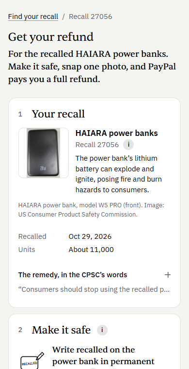
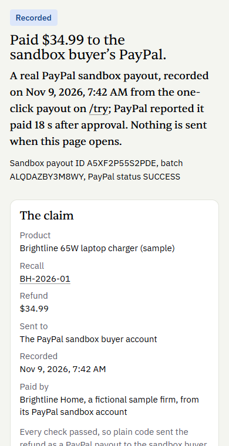
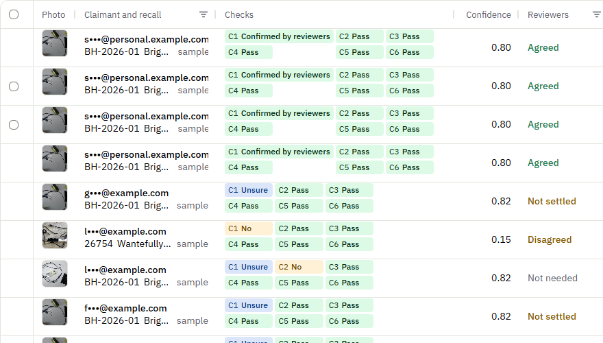
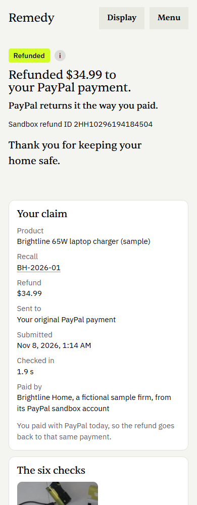
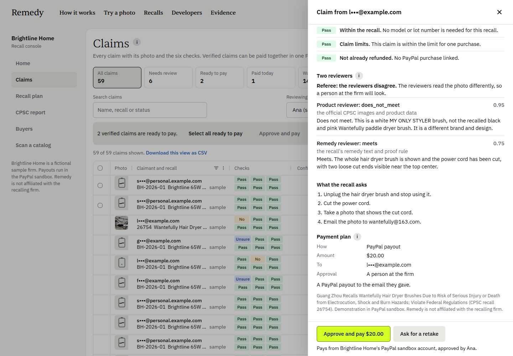
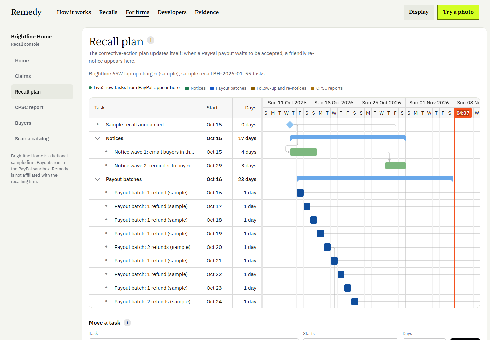
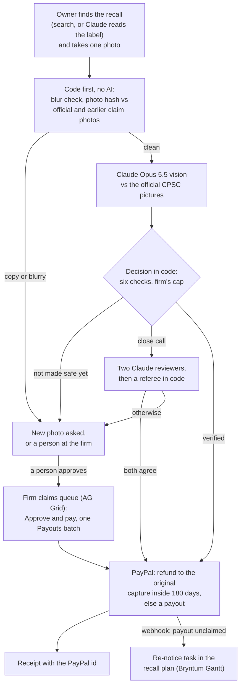

# Remedy

[](https://github.com/usv240/remedy/actions/workflows/ci.yml) [](https://github.com/usv240/remedy/actions/workflows/sandbox-e2e.yml)

<p>
  
  
  
</p>

Remedy pays a recall refund through PayPal in seconds, once one photo shows the recalled product made safe. It is for owners of recalled products and the firms recalling them. It runs on the PayPal sandbox at [remedy-y0ym.onrender.com](https://remedy-y0ym.onrender.com).

**Demo video:** [youtu.be/n5HRqnyH4so](https://youtu.be/n5HRqnyH4so) · **Try it in 30 seconds:** [Test it](#test-it) · **Claims to evidence:** [docs/evidence-index.md](docs/evidence-index.md)

## The problem

**447 of 1,239** US consumer product recalls since January 2024 (36.1%) refund a photo of the product made safe, more each year: 54 in 2024, 151 in 2025 and 242 in 2026 so far ([CPSC Recalls API](https://www.saferproducts.gov/RestWebServices/Recall?format=json&RecallDateStart=2024-01-01)). Together they offer **$471.1 million** in refunds at the lowest stated price ([`value.json`](content/recalls/value.json)). Today people check each photo by hand, and a recall claim portal pays "via check within 10-15 business days" ([its own page](https://www.recallrtr.com/SiteResources/3in1grill/locales/en/translation.json)).

## What it does

**For owners**

1. **Find the recall:** search, or snap the label; Claude reads the model number and UPC, and code finds the recall in the CPSC list.
2. **Make it safe, take one photo:** the official remedy becomes up to four short steps, such as "cut the cord". No account.
3. **Six checks:** right product, made safe, own photo, within the recall, claim limits, not already refunded.
4. **Get paid:** a PayPal purchase from the last 180 days is refunded to its original payment; otherwise a PayPal payout to an email, a phone or Venmo (in the sandbox, a phone payout stands in for Venmo).

**For firms**, at [`/firm`](https://remedy-y0ym.onrender.com/firm). Brightline Home and Fernway Home are fictional sample firms.

1. **Claims queue** (AG Grid): bulk **Approve and pay** sends the chosen payouts in one PayPal Payouts batch.
2. **Recall plan** (Bryntum Gantt): a payout nobody accepts, reported by PayPal's webhook, becomes a re-notice task, live.
3. **CPSC monthly report:** numbers counted in SQL; Claude Haiku 5.5 writes the summary from them.
4. **Shared photo fingerprints:** a photo claimed at Brightline Home and sent for Fernway Home's recall is held for a person before any model call; only the hash and a row id cross ([`network-run.json`](content/public/network-run.json)).

**For AI assistants:** an MCP server with eight tools: find a recall, check a label or a photo, open a claim ([TESTING.md](TESTING.md#mcp)).

| Refund to the PayPal purchase | Two reviewers | Re-notice task |
|---|---|---|
|  |  |  |

## How it works



Claude reads; plain code decides the money. `decide()` in [`decide.ts`](src/lib/verify/decide.ts) settles each claim, and `planPayment()` in [`router.ts`](src/lib/payments/router.ts) picks the route and the amount. Every payment status goes into a hash-chained audit ledger.

## Built with

| PayPal (sandbox) | What it does in Remedy |
|---|---|
| Payouts | One item per claim; bulk Approve and pay is one batch ([`payouts.ts`](src/lib/payments/payouts.ts)) |
| Refunds | Back to the original capture inside 180 days, with `PayPal-Request-Id` so a retry never pays twice ([`refunds.ts`](src/lib/payments/refunds.ts)) |
| Orders v2, JavaScript SDK v6 | The sample shop at `/try/shop`: buy, claim, and see the refund go back |
| Transaction Search | Finds the buyers who paid the firm with PayPal |
| Disputes | Read before any refund |
| Webhooks | 15 event types, each verified with PayPal; an unclaimed payout becomes a re-notice task ([`webhooks.ts`](src/lib/payments/webhooks.ts)) |
| PayPal MCP server | Reads the order with its read-only `get_order` tool before a refund ([`mcp.ts`](src/lib/paypal/mcp.ts)) |

| Claude | What it does in Remedy |
|---|---|
| Opus 5.5, vision | Compares each photo with the official CPSC pictures and checks each made-safe step |
| Opus 5.5, two reviewers | On a close call, one sees only the pictures, the other only the remedy text; a referee in code pays only when both agree |
| Opus 5.5, labels | Reads the model number and UPC from a label photo |
| Opus 5.5, Message Batches | Read 583 recall remedies into proof rules in one run ($14.01); every field right on 113 of 130 benchmark remedies, against 73 for keyword rules (draft labels) |
| Haiku 5.5 | Writes the CPSC report summary from SQL numbers |

| Tool | What it does in Remedy |
|---|---|
| AG Grid | The firm's claims queue, with bulk Approve and pay |
| APIMatic | Generated the PayPal Server SDK that carries every Orders and Payments call ([`sdk-rest.ts`](src/lib/paypal/sdk-rest.ts)) |
| Bryntum | Gantt holds the recall plan, where re-notice tasks arrive live; Scheduler shows review cases |
| Channel3 | Finds a safe in-stock replacement at or under the refund, checked against recalls |
| Elastic | Recall search: keyword plus semantic (jina-embeddings-v3), reranked by jina-reranker-v3 |
| Render | Hosts the web service, a worker, a daily recall job and Postgres 17 from one [`render.yaml`](render.yaml) |

## Why it matters

- **Owners rarely hear of recalls.** Almost 70% of US adults had not heard of a recall for anything they own in five years ([Consumer Reports, 2019](https://www.consumerreports.org/recalls/when-recalls-fail/)).
- **Claims that are not genuine.** The CPSC asked for information on them in April 2026 ([91 FR 20138](https://www.govinfo.gov/content/pkg/FR-2026-04-15/pdf/2026-07328.pdf)); on its docket, one person filed 767 registrations under one name ([comment](https://downloads.regulations.gov/CPSC-2026-0067-0013/attachment_1.pdf)) and one device over 400 claims ([comment](https://downloads.regulations.gov/CPSC-2026-0067-0010/attachment_1.pdf)).
- **A full remedy moves recalls.** Across 338 CPSC recalls from 2001 to 2013, the share corrected was 11.4% higher on average with a full remedy than a partial one ([Raithel, Hock and Mafael, 2024](https://link.springer.com/article/10.1007/s11747-023-00967-x)).
- **A simpler ask raises claims.** From a tax credit, not a recall: of 35,050 filers who had not claimed the Earned Income Tax Credit after a first notice, a simpler second notice raised claiming from 14% to 23%, and showing the amount to 31% ([Bhargava and Manoli, 2015](https://www.aeaweb.org/articles?id=10.1257/aer.20121493)).

That a faster refund raises claims is an inference from the cited studies (a full remedy against a partial one; a simpler tax-credit notice), not a measurement of Remedy. Every source: [docs/research.md](docs/research.md).

**Who pays Remedy:** the firm, a fee per finished claim. Proposed: $1.00 per finished claim (a proposal, not a price list), so a refund costs the firm $1.25 with PayPal's $0.25 payout fee, against the $2 to $4 a paper check costs its issuer today.

## Results

Each is counted by code from a file in this repo, in full in [docs/results.md](docs/results.md).

- **0 of 46 paid wrongly**, on 28 photos with a known answer, 10 of them by other photographers. Held for a person when it could have been paid: 1 of 4 decisions, all on one photo ([`errors.ts`](src/components/evidence/errors.ts)).
- **16 to 19 seconds** from approval to a PayPal payout reaching SUCCESS, in 12 sandbox runs. PayPal marked the refund to the original PayPal purchase COMPLETED at once; PayPal says a refund takes 3 to 5 business days to reach the buyer ([`measured.json`](content/public/measured.json), [`e2e-transcript.json`](content/public/e2e-transcript.json)). Claude does the photo check in **about 11 seconds** (about 22 when the two reviewers look).
- **7 of 7** stopped by code alone, before any AI call: copies of the official picture, a reused photo, a blurry one and a picture from another recall. The hash comparison takes a median of 2 ms ([`verify-runs.json`](content/public/verify-runs.json)).
- **308 of 400** altered copies of one claimed photo held by the shared hash pool before any model call, in a replay of the pattern on the CPSC's docket; none of the 400 was paid ([`docket-replay.json`](content/public/docket-replay.json)).
- **2,201 of 2,216** label readings found their recall; **511 of 511** products no recall lists matched none, in code with no AI call ([`label-eval.json`](content/public/label-eval.json)).

## Test it

No account needed, and all money is PayPal sandbox practice money. Full guide: [TESTING.md](TESTING.md).

- **In 30 seconds:** press **Try a photo** on the [home page](https://remedy-y0ym.onrender.com), then **Run it** on the first photo (Brightline's sample charger, cord cut) to see it verified, then **Send $34.99 to the sandbox buyer**: a real PayPal sandbox payout. A paid receipt without sending one: [`/r/recorded`](https://remedy-y0ym.onrender.com/r/recorded).
- **Snap the label:** on [`/claim#snap`](https://remedy-y0ym.onrender.com/claim#snap), press a sample label. Claude's recorded reading replays, and code looks it up in the recall list.
- **Firm console, 2 minutes:** on [`/firm/claims`](https://remedy-y0ym.onrender.com/firm/claims), press **Sign in as Ana (sample reviewer)**, **Select all ready to pay** and **Approve and pay**: one Payouts batch. Open the look-alike hair dryer claim (recall 26754) for the two reviewers, then [`/firm/plan`](https://remedy-y0ym.onrender.com/firm/plan) and [`/firm/reports`](https://remedy-y0ym.onrender.com/firm/reports).

**Buy, claim and refund to the original purchase, 3 minutes:**

1. On [`/try/shop`](https://remedy-y0ym.onrender.com/try/shop), press the PayPal button for the $34.99 sample charger.
2. Log in with the shared PayPal sandbox buyer: email `sb-tvnmx53636325@personal.example.com`, password `D.}t1I^T`. Use this login, not a test card (the sandbox declines those at $34.99), and please keep the password.
3. Press **Now claim it**, **Use Brightline's sample photo**, then **Check my photo**.
4. **Verified:** press **Send my refund**. The receipt reads **Refunded $34.99 to your PayPal payment.**

## Run it yourself

Node 24 and Docker. Only `DATABASE_URL` is required ([`.env.example`](.env.example)); every other service falls back without its key.

```bash
git clone https://github.com/usv240/remedy && cd remedy
npm ci
cp .env.example .env.local
docker compose up -d                                # Postgres 17
npm run db:migrate && npm run db:load && npm run db:seed
npx tsx --env-file=.env.local scripts/seed-firm.ts  # sample claims and plan
npm run dev                                         # http://localhost:3300
npm test                                            # unit tests, no keys or database needed
```

Without a Claude key, recorded model answers replay and new photos go to a person at the firm. PayPal keys: [TESTING.md](TESTING.md#paypal-keys). Every other suite: [TESTING.md](TESTING.md#run-the-tests).

## Read more

[How it works](docs/how-it-works.md) · [Results](docs/results.md) · [Research](docs/research.md) · [Operations, security and privacy](docs/operations.md) · [Claims to evidence](docs/evidence-index.md) · [Testing guide](TESTING.md)

## Credits and license

Recall data and images: the U.S. CPSC, public domain. Sample charger photos: Dmitry G, Wikimedia Commons, public domain ([`CREDITS.json`](public/samples/charger/CREDITS.json)). Remedy is not affiliated with the CPSC or any firm. On real CPSC recalls, Remedy's PayPal sandbox account stands in for the recalling firm and pays the refund, so no real money moves. [MIT License](LICENSE).
