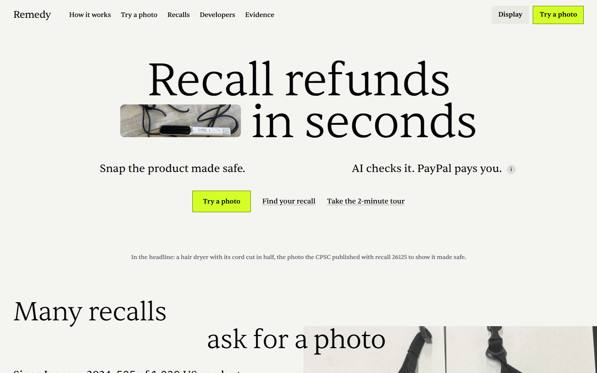
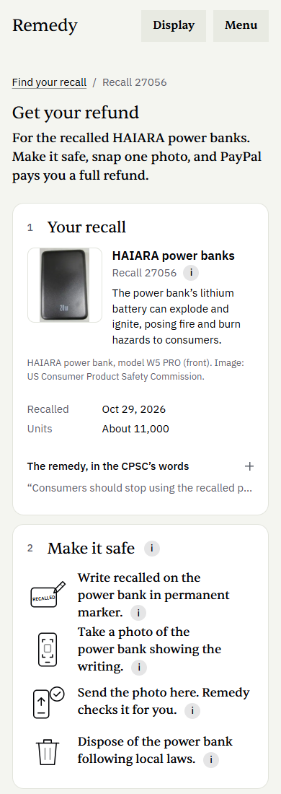
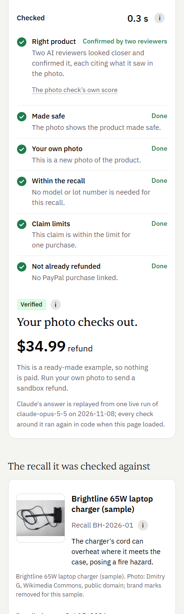
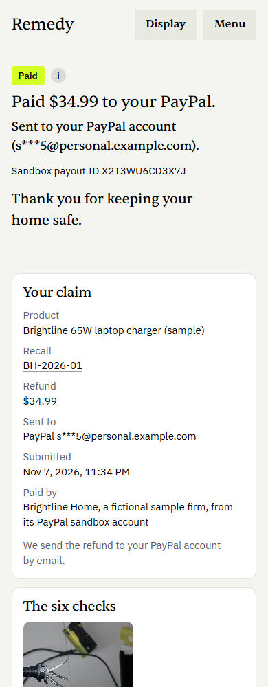
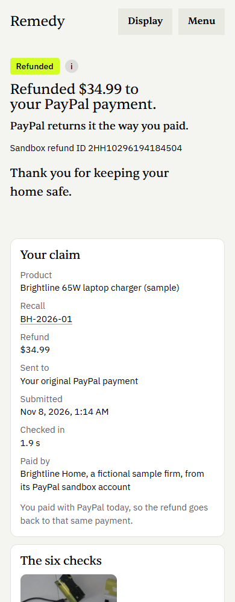
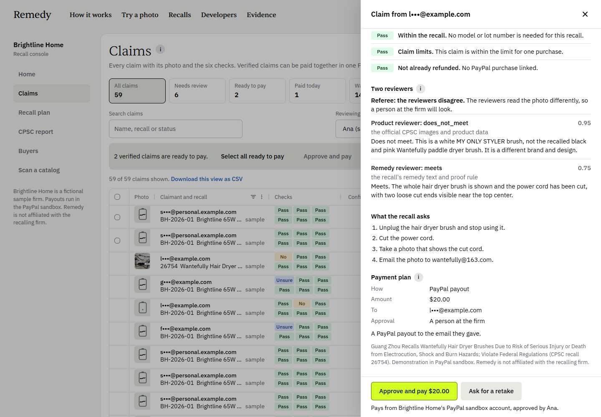
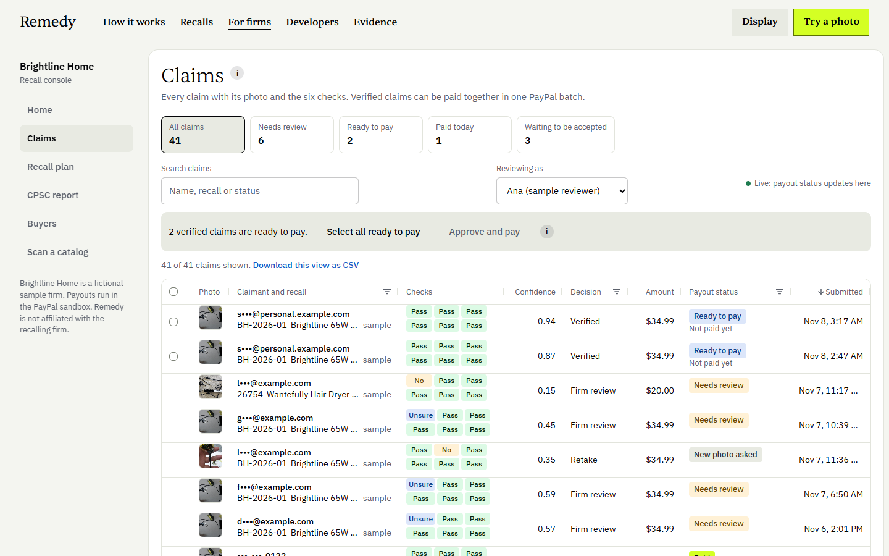
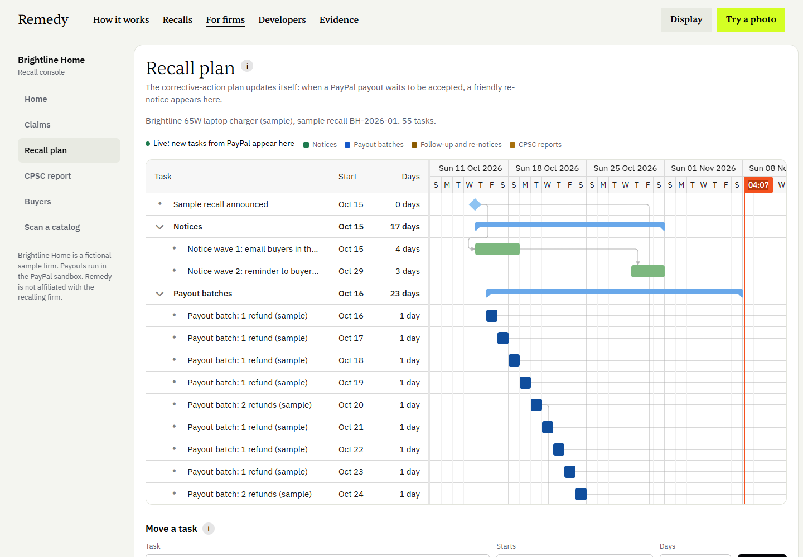
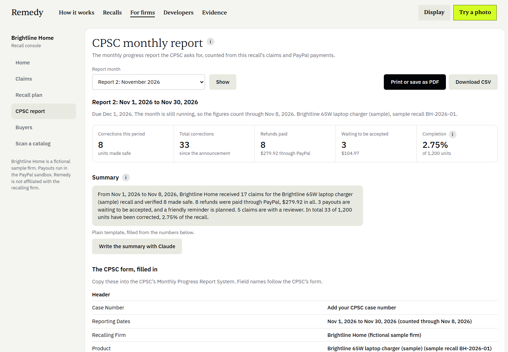
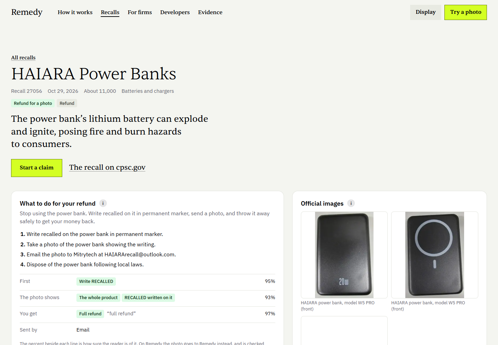

# How Remedy works

Part of the [Remedy README](../README.md). Screenshots, the claim from recall to refund, what plain code decides, each tool's one job, and how the AI cost is kept low.

## See it

| Recall refunds in seconds: the CPSC's own made-safe photo sits in the headline | On a phone: the recall's remedy as a checklist |
|---|---|
|  |  |
| **Six checks, in plain words** | **Paid through PayPal** |
|  |  |
| **Back to the original PayPal purchase, inside 180 days** | **Two reviewers when a photo needs a closer look** |
|  |  |
| **The firm's claims queue (AG Grid)** | **The recall plan updates itself (Bryntum Gantt)** |
|  |  |
| **The CPSC monthly report, drafted from the numbers** | **Every recall, read as a proof rule** |
|  |  |

## How it works

1. **Recall.** Claude Opus 5.5 reads the official remedy into a structured proof rule: what to cut or mark, the words to write, what the photo must show, and the refund. The owner sees it as up to four short steps.
2. **Photo.** The owner opens the claim link on a phone and takes one photo. No account. A blur and light check runs in the browser before upload.
3. **Checks.** Six checks, each with a plain reason:

   | Check | What it asks | How |
   |---|---|---|
   | C1 Right product | Is it the recalled product? | Claude vision against the official CPSC images, product names and model numbers; passes at 0.85 |
   | C2 Made safe | Was it made safe as the recall asks? | Claude vision checks each required action; marker words are read and compared in code |
   | C3 Your own photo | Is it the owner's own photo? | A 64-bit perceptual hash (dHash) against the recall's official images and earlier claim photos within 10 bits, and against every other recall's published pictures (a catalog of 1,779 distinct ones across all recalls) and every photo claimed on any recall within 4 bits, in all eight orientations; Claude checks for a photo of a screen or printout |
   | C4 Within the recall | Is it a recalled model, lot or date? | Identifiers read from the photo, compared in code with the recall's ranges, when the rule needs them |
   | C5 Claim limits | Is it within the units bought and the recall's units? | Code, per person: a second claim on the recall that shares the payee, the PayPal purchase, the PayPal account that paid, or the hashed network and browser goes to a person, so a new email alone does not reset it |
   | C6 Not already refunded | Has the linked PayPal purchase been refunded or disputed? | PayPal's capture, its order's refunds (read through PayPal's own MCP server with its read-only `get_order` tool, the Orders API as the fallback) and the Disputes API |

4. **Decision, in code.** Verified when all six pass and the amount is at or under the firm's auto-approve cap. Retake, with friendly guidance, when the product is not made safe yet, the photo is blurry, it is not the owner's own, or a person (a face, a body, a child) is in it. Otherwise two Claude reviewers look, one seeing only the official images and the other only the remedy text; each must cite what it saw, and a referee in code acts only when both counted votes agree. Anything else goes to a person at the firm.
5. **Payment, in code.** A purchase made with PayPal in the last 180 days is refunded to its original capture. Otherwise the owner chooses a PayPal payout by email or phone, Venmo, or a safe replacement. The refund is the firm's amount or the purchase amount, whichever is lower.
6. **The firm's side.** A claims queue, a corrective-action plan that adds a re-notice when a payout waits to be accepted, and the CPSC monthly progress report.

Claude reads remedies and photos. The money math, the decision and the payment route are plain code, never the model.

## What the AI never decides

| Plain code decides | Where |
|---|---|
| Whether a claim is paid, sent to a person, or asked for a new photo | `decide()` in [`src/lib/verify/decide.ts`](../src/lib/verify/decide.ts) |
| Every pass mark (0.85 for the right product, 0.7 for a made-safe step) | `LIMITS` in [`src/lib/verify/checks.ts`](../src/lib/verify/checks.ts) |
| The refund amount: the firm's amount or the purchase amount, whichever is lower | `computeAmount()` in `checks.ts`; [`src/lib/payments/router.ts`](../src/lib/payments/router.ts) |
| Which recall and proof rule a claim is checked against | `ruleFor()` in [`src/app/api/claims/_lib/recall.ts`](../src/app/api/claims/_lib/recall.ts) |
| The marker word, model and lot ranges, claim limits, the match with official and earlier photos on every recall, and when the screen signs Claude lists outweigh its own label | `checks.ts` (`CONTRADICTING_SIGNS`), `identifiers.ts`, `dhash.ts` (`CATALOG_MAX_DISTANCE`) |
| When money moves and to whom: the auto-approve cap, the firm's daily auto-pay limit ($350 a day on the sample recall; the rest waits for a person), the refund to the original purchase inside 180 days, or the payout | `planPayment()` in `router.ts`, `autoPayVerdict()` in [`src/lib/firm/limits.ts`](../src/lib/firm/limits.ts) |
| Deleting a photo that shows a person, and every owner's photo 90 days after the decision | [`src/lib/ops/photos.ts`](../src/lib/ops/photos.ts) |

What Claude does instead: it reads each remedy into a proof rule once, ahead of any claim; it describes the photo (how closely it matches, whether each step is done, any writing or label, whether it is a camera photo, whether a person is in it); two reviewers cite what they see when a check is unclear, and a referee in code counts only votes whose evidence checks out; it reads unclear rows in a catalog scan; and Claude Haiku 5.5 writes the monthly report's summary from numbers SQL counted.

**The two reviewers** both run on Claude Opus 5.5 and read two different rulebooks, the official pictures and the remedy text; a disagreement goes to a person. Kohli (2026) found that panels from one model family share errors, so the split is by rulebook, and each reviewer's model is one setting (`REMEDY_REVIEWER_MODEL_PRODUCT`, `REMEDY_REVIEWER_MODEL_REMEDY`). Lineage: [`/evidence/photo-checks#lineage`](https://remedy-y0ym.onrender.com/evidence/photo-checks#lineage).

## What is inside

Each tool has one job. [`/stack`](https://remedy-y0ym.onrender.com/stack) lists them with their files, and [`/status`](https://remedy-y0ym.onrender.com/status) shows whether each is live or on its fallback.

- **PayPal** pays the refund. All calls go to the sandbox ([`src/lib/payments`](../src/lib/payments)).
  - **Payouts:** one item per claim (`sender_item_id` is the claim id), to an email or a US phone number. Venmo falls back to a phone payout in the sandbox, labelled. Bulk **Approve and pay** sends the chosen claims in one batch.
  - **Refunds:** `POST /v2/payments/captures/{id}/refund` with `PayPal-Request-Id`, inside PayPal's 180-day window.
  - **Orders v2 with the JavaScript SDK v6:** the sample shop at [`/try/shop`](https://remedy-y0ym.onrender.com/try/shop), so anyone can buy, claim and see the refund go back to that payment; and safe replacement orders paid to a retailer stand-in.
  - **Transaction Search:** finds buyers who paid the firm with PayPal, in 31-day slices, matched to the recalled product (`/firm/buyers`).
  - **Disputes:** read before a refund, as part of C6.
  - **PayPal's MCP server:** C6 reads the purchase's order through its `get_order` tool, read only ([`src/lib/paypal/mcp.ts`](../src/lib/paypal/mcp.ts), one sandbox read recorded in [`content/public/paypal-mcp-read.json`](../content/public/paypal-mcp-read.json)).
  - **Onboarding firms:** Today a firm connects its own PayPal REST app, checked with PayPal and stored sealed, because PayPal's Partner Referrals onboarding, the production path, answered this sandbox app with 403 NOT_AUTHORIZED on November 7, 2026. A production rollout onboards firms through PayPal's Partner Referrals API and calls PayPal for each with a `PayPal-Auth-Assertion` header, a change in [`src/lib/paypal/firm-account.ts`](../src/lib/paypal/firm-account.ts) (listed on [`/stack`](https://remedy-y0ym.onrender.com/stack#onboarding)).
  - **Each firm's own PayPal account:** PayPal's Partner Referrals API needs an app PayPal has approved as a partner, and the sandbox app gets NOT_AUTHORIZED, so a firm connects its own PayPal REST app in its console instead: the client ID and secret are checked with PayPal, sealed with AES-256-GCM and never shown again (only the last four characters of the client ID), and that firm's refunds and payouts run on them ([`src/lib/paypal/firm-account.ts`](../src/lib/paypal/firm-account.ts)). Brightline Home, the sample firm, keeps the platform's sandbox account; its console is open to everyone, so there the pair is checked and never stored.
  - **Webhooks:** 15 payout, refund and checkout events, each checked with PayPal's signature verification (or PayPal's own record of the event) and handled once. Every status change writes to a hash-chained audit ledger.
- **Claude Opus 5.5** reads every remedy into a proof rule (structured output validated by Zod, then a self-check pass and a deterministic lint, with the Message Batches API), checks each photo with vision, and runs the two reviewers. **Claude Haiku 5.5** writes the monthly report's short summary from numbers SQL counted; any figure not in the report sends it back to a plain template.
- **Elastic** searches every recall in plain words: keyword and semantic retrieval (`semantic_text` on jina-embeddings-v3) fused by reciprocal rank, then reranked by jina-reranker-v3, over the `remedy-recalls` index. It powers the home page showcase, `/recalls`, "Find your recall", the replacement recall check, the API and MCP. Without Elastic, an in-app BM25 search over the same recalls stands in.
- **Channel3** finds a safe replacement: in-stock products at or under the refund amount, each checked against recalls before the owner sees it, then paid with Orders v2. Without a key, the owner is offered a refund.
- **Bryntum Gantt and Scheduler** (trial, with its watermark) hold the corrective-action plan at `/firm/plan`: the announcement, notice waves, payout batches, follow-ups and CPSC reports, with real dependencies. When PayPal reports a payout waiting to be accepted, a re-notice task appears in the open Gantt without a reload (server-sent events). Tasks move by drag or with a form. Below it, the Scheduler shows each review case by reviewer.
- **AG Grid** runs the firm's claims queue at `/firm/claims` (its first rows are rendered on the server, so claims show at once): a photo column, masked claimants, the six checks, quick views (Needs review, Ready to pay, Paid today, Waiting to be accepted) and bulk Approve and pay. Each row opens a drawer with the six checks, and the two reviewers' notes when they ran.
- **APIMatic** generated the PayPal Server SDK (`@paypal/paypal-server-sdk`) that carries every Orders and Payments call as a direct method on its controllers (`ordersController.createOrder`, `getOrder` and `captureOrder`; `paymentsController.getCapturedPayment`, `refundCapturedPayment` and `getRefund`): the sample shop's checkout and capture, replacement orders, reading captures, and refunds to the original purchase, each attempt with its own `PayPal-Request-Id` ([`src/lib/paypal/sdk-rest.ts`](../src/lib/paypal/sdk-rest.ts)). Payouts, Transaction Search and Disputes are outside the SDK and use PayPal's REST API.
- **Render** hosts it: [`render.yaml`](../render.yaml) is one Blueprint for the web service, a background worker for photo checks and payouts, a daily cron job that calls `POST /api/ops/recalls/daily` with the server's secret, and Postgres 17; it applies the reviewed schema, loads the recall data and seeds the sample firm before each release.
- **MCP server** at `/api/mcp` (streamable HTTP) with eight tools: `search_recalls`, `check_label`, `scan_catalog`, `get_proof_rule`, `verify_photo`, `open_claim`, `claim_status` and `ping`. Found by agents through an MCP Server Card (`/api/mcp/server-card`), an AI Catalog (`/.well-known/ai-catalog.json`), `/llms.txt` and [`server.json`](../server.json).
- **For marketplaces and retailers:** `POST /api/v1/scan` checks a whole catalog at once (paste or upload a CSV on `/firm/scan`) and returns, per item, whether an active photo-refund recall covers it and the claim link; `GET /api/embed/badge?recall=` is a one-iframe "Get your refund" badge for any product page. "Find your recall" also asks the FDA and NHTSA when the CPSC has no match, labelled by agency. A daily job pulls each day's new CPSC recalls, reads their proof rules and refreshes search.
- **Public API:** free sandbox keys, OpenAPI 3.1 at `/openapi.json`, docs with recorded responses at `/developers/docs`, and a live playground at `/developers`.

Built with Next.js 16, React 19, TypeScript, Postgres 17, Drizzle, Zod and sharp.

## How the AI cost is kept low

Each photo check is one Claude vision call, made only after the free checks pass. Reading all 583 remedies cost $14.01 in one batch run at half price. Five more measures:

1. **Identical requests replay** in local and test runs: a request that matches one already answered (same model, prompt, images and settings) is read back from `AI_CACHE_DIR` instead of paid for again. It is never set on the hosted site.
2. **An identical photo reuses its result.** The same photo for the same recall, rule and engine version reads the model's answer from the database. Every check that depends on the claim (earlier claims, limits, refunds, the amount) still runs again in code.
3. **Images are downscaled** before the vision call: up to 16% fewer input tokens on large photos, and 13% on a 12-megapixel photo, counted with the token-counting API ([`content/verify/tokens.json`](../content/verify/tokens.json)).
4. **The recall's part of the prompt is cached.** Instructions, recall data and official images come first, 71% to 75% of a claim's prompt, so repeat checks on one recall read them from Claude's prompt cache.
5. **A daily spend cap** (`AI_DAILY_USD`, $5 a day on the hosted site). Past it, every free check still runs and a person at the firm looks at the rest. Each call's cost is logged, and today's spend shows on `/status`.
